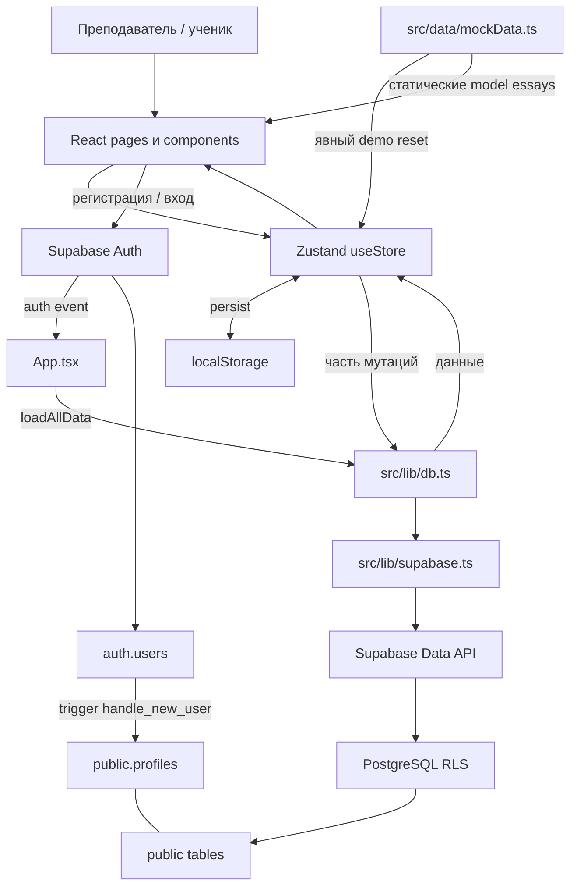

# System Overview

IELTS Peer Review — клиентское приложение для групповой практики IELTS Writing. Архитектура: React SPA → Supabase Auth/Data API → PostgreSQL. Отдельных backend-приложения, API routes, worker, middleware, ORM и LLM-интеграции в репозитории нет.

Эта карта описывает исходники, проверенные 2026-10-01 и уточнённые после live RLS rollout 2026-10-03. CURRENT — существует в коде; PARTIAL — цепочка неполна; RECOMMENDED — предложение; UNKNOWN — нет подтверждения. Облачные schema/grants/RLS сверены; Auth-настройки и публикация нового frontend ещё не подтверждены. Реестр существенных проблем: [TECH_DEBT.md](TECH_DEBT.md).

# Architecture Diagram

Стрелка «часть мутаций» существенна: учительские оценки, часть уведомлений и геймификация не записываются на сервер.

# Frontend

- `src/main.tsx`: React root в StrictMode, подключение `src/index.css`.
- `src/App.tsx`: BrowserRouter, общий ProtectedRoute, auth listener и загрузка всех доступных коллекций. Все страницы импортируются статически.
- `src/pages/`: композиция сценариев, локальные формы, фильтры, агрегаты. Отдельных directories services/hooks нет.
- `src/components/layout/AppShell.tsx`: Sidebar, Header, BottomBar, ToastContainer. ReviewPage имеет отдельную полноэкранную оболочку и не подключает ToastContainer.
- Активная стилизация: CSS variables и utility/component classes в `src/index.css`, Tailwind, inline styles. Светлая/тёмная тема переключает класс `dark` на html. `src/App.css` в текущий граф импортов не входит.
- Формы используют useState; глобальные сущности и активная рецензия находятся в store. RU/EN текст встроен в JSX; локализация не вынесена.

| URL | Component / purpose |
| --- | --- |
| `/` | `src/pages/LoginPage.tsx`: вход/регистрация; авторизованный пользователь направляется в dashboard |
| `/dashboard` | `src/pages/DashboardPage.tsx`: ролевой обзор |
| `/classrooms` | `src/pages/ClassroomsPage.tsx`: классы пользователя |
| `/classrooms/:classroomId` | `src/pages/ClassroomPage.tsx`: задания, ученики, аналитика класса |
| `/assignments` | `src/pages/AssignmentsPage.tsx`: каталог с фильтрами |
| `/assignments/:assignmentId` | `src/pages/AssignmentPage.tsx`: редактор/отзыв ученика либо таблица учителя |
| `/essays` | `src/pages/EssaysPage.tsx`: архив собственных работ |
| `/reviews` | `src/pages/ReviewsPage.tsx`: ученики, очередь, история, учительский обзор |
| `/review/:essayId` | `src/pages/ReviewPage.tsx`: редактор рецензии |
| `/results` | `src/pages/ResultsPage.tsx`: собственные результаты и SVG-графики |
| `*` | `src/pages/NotFoundPage.tsx` |

ProtectedRoute ждёт `authReady` и `currentUser`, установленный после загрузки профиля из БД. ClassroomPage/AssignmentPage/ReviewPage проверяют доступ к объекту; RLS остаётся серверной границей безопасности.

# Backend

CURRENT: управляемые Supabase Auth и PostgreSQL. `handle_new_user` создаёт профиль с отображаемыми metadata. `join_classroom_by_code` проверяет приглашение и сохраняет членство; private SECURITY DEFINER helpers проверяют владельца/членство без рекурсии RLS. Review trigger защищает авторство вкладов и teacher fields, пересчитывает peer Band; отдельный trigger переводит essay.status в `reviewing` после частичной и в `reviewed` после полной/учительской оценки. Слияние JSON и формирование уведомлений остаются в браузере.

RECOMMENDED: атомарное согласование конкурирующих вкладов и уведомлений; существующий authorization guard не заменяет atomic merge/versioning.

# API

Собственных HTTP endpoints нет. Контракт клиента — экспортированные функции `src/lib/db.ts`; транспорт предоставляет Supabase SDK. `src/lib/supabase.ts` создаёт единственный клиент из двух VITE-переменных.

| Functions in db.ts | Operation |
| --- | --- |
| fetchAllProfiles / upsertProfile | Чтение profiles; upsertProfile сейчас не вызывается приложением |
| fetchAllClassrooms | Загрузка classrooms и classroom_students, сборка studentIds в браузере |
| insertClassroom / joinClassroomByCode | Создание своего класса / RPC вступления по коду |
| fetchAllAssignments / insertAssignment | Чтение / создание задания |
| fetchAllEssays / upsertEssay | Чтение; update по существующему ID либо insert |
| fetchAllReviews / upsertReview | Чтение; update/insert целой рецензии с JSON-полями |
| fetchNotificationsForUser / insertNotification | Последние 50 личных уведомлений / insert в разрешённом учебном контексте |
| markNotificationReadDb / markAllNotificationsReadDb | Update read; массовая функция не подключена к store |

Названия upsertEssay/upsertReview не означают SQL upsert по бизнес-ключу: это update либо insert с распознаванием временного ID по префиксу. Update не отправляет неизменяемые FK/автора, требует ровно одну возвращённую запись и не переходит к insert при отказе. Нет pagination для основных сущностей, общей модели ошибок, retry или runtime-валидации ответов. Неиспользуемый upsertProfile не поддерживается новыми grants на INSERT: профиль создаёт Auth trigger.

# Database

Текущая декларация новой схемы: `supabase_schema.sql`; frontend-модель: `src/types/index.ts`; преобразования: `src/lib/db.ts`. Для существующей БД есть последовательные `supabase/migrations/202610010001_classroom_rls.sql`, `202610030001_review_status.sql` и `202610030002_profile_trigger_acl.sql`; migration runner и generated DB types отсутствуют. `create table if not exists` не обновляет существующие таблицы: перед live rollout требуется сравнение схемы, grants и policies.

| Table | Responsibility / relationships |
| --- | --- |
| profiles | PK/FK к auth.users; имя, avatar-инициалы, роль, synthetic email |
| classrooms | Владелец teacher_id → profiles; уникальный join code |
| classroom_students | Many-to-many, составной PK classroom_id + student_id |
| assignments | classroom_id → classrooms; учебный prompt, тип, дедлайн, minWords, requiredReviews |
| essays | assignment_id, author_id; уникальная пара assignment_id + author_id; текст, статус, время |
| reviews | essay_id, reviewer_id; оценки, комментарии и участники в JSONB; учительские метаданные |
| notifications | recipient_id как text; legacy `all` скрыт; контекстные UUID без FK проверяются access helper |

Большинство основных связей удаляется cascade; reviewer_id в reviews не имеет cascade, а teacher_id там не FK. Band/checklists/индексы комментариев хранятся в JSON без серверной проверки структуры. Уникальности review на essay либо essay+reviewer нет. Кроме индексов PK/unique, дополнительных индексов SQL не объявляет.

Не представлены в SQL: model essays, XP/streak/badges, история версий эссе, keystrokesCount/pasteAttempts/averageWpm. Последние три присутствуют в TS и UI, но отсутствуют также в db mappings; после загрузки с сервера исчезают.

# Authentication & Authorization

1. LoginPage преобразует имя в синтетический email через `nameToFakeEmail`, затем вызывает signUp/signInWithPassword. Пользователь выбирает student/teacher при регистрации.
2. SQL trigger копирует отображаемые metadata в profiles. App строит `currentUser` из загруженного собственного профиля. `role` — самостоятельно выбранная UI preference; ни она, ни user_metadata не участвуют в критических решениях доступа.
3. Auth callback запускает загрузку вне session lock SDK; до её завершения защищённый UI закрыт. Generation guard игнорирует результаты старой session; повторный SIGNED_IN/refresh token того же пользователя не стирает открытый редактор.
4. Header и Sidebar вызывают store.logout → Supabase signOut; при успехе очищаются пользовательские коллекции, activeReview и gamification. При ошибке logout не подменяет состояние успешным выходом.

CURRENT в исходниках: RLS и явные grants на семи таблицах. SELECT profiles ограничен своим профилем/общими классами; classrooms/memberships/assignments — владельцем/членством. Записи assignments меняет только владелец класса; essays пишет только автор-участник, чужие drafts закрыты даже преподавателю. Прямой INSERT membership запрещён; join доступен через проверку кода. Владельца/контекст/автора нельзя менять через column grants. DELETE запрещён клиенту, кроме выхода участника/удаления участника владельцем.

Reviews доступны для отправленных эссе класса. Одноклассники могут дополнять свободные критерии/свои вклады, но trigger отклоняет перезапись чужих criteria/evaluators/comments/contributors и защищает teacher fields. Legacy завершённые отзывы без evaluators принадлежат reviewer_id. Общий verdict меняет первоначальный reviewer или владелец класса. Учительская коррекция доступна только владельцу класса и блокирует дальнейшую peer правку этой записи. JSON-author IDs подтверждаются при записи и не дают членство или доступ к классу.

Notifications читает адресат с доступом к контексту; UPDATE разрешает только `read`. INSERT допускается владельцу в своём классе или рецензенту после сохранения review — автору работы/владельцу класса. Несогласованные ссылки, чужие адресаты и `all` запрещены. `anon` не имеет CRUD grants; protected RPC доступен только authenticated. Полная матрица и live rollout проверки: `supabase/tests/README.md`.

Широкие live policies/grants были подтверждены до миграции. 2026-10-03 три миграции применены к проекту Supabase `bazsuolubwqulkeqvwlt`; postflight подтвердил 19 адресных policies, отсутствие table SELECT для `anon`, приватную схему без `anon` USAGE и доверенное владение helper functions. Два существующих ученика успешно вошли и увидели свой класс. Межклассовый тест с реальными JWT и публикация нового клиента ещё нужны. Пользовательские metadata нельзя считать доверенным источником авторизации: это отдельно подтверждается [документацией Supabase RLS](https://supabase.com/docs/guides/database/postgres/row-level-security).

Нет реализованного восстановления пароля. Нормализация имён допускает коллизии; для имён, очищающихся в пустую строку, используется меняющийся timestamp. Возможность входа после регистрации зависит от email confirmation в Supabase; настройка UNKNOWN.

# AI / LLM Architecture

CURRENT: AI SDK, model calls, embeddings, RAG, evals, token accounting и расходы на inference отсутствуют. Оценки выставляют люди; Band вычисляется детерминированно. Нельзя описывать приложение как AI-экзаменатора. Возможные будущие AI-функции — только продуктовая гипотеза, не обязательная часть MVP.

# Prompt Architecture

`Assignment.prompt` — текст задания преподавателя: CreateAssignmentModal → store.createAssignment → db.insertAssignment → assignments.prompt → AssignmentPage/ExamSimulatorModal.

`src/data/mockData.ts` содержит учебные темы, статические model essays с аннотациями и образцы комментариев. `src/components/review/CriteriaPanel.tsx` содержит checklists, `FloatingTooltip.tsx` — заготовки комментариев. LLM system/developer prompts и prompt registry отсутствуют.

# External Services

CURRENT: Supabase Auth/Data API; Google Fonts через CSS import и preconnect в `index.html`. Нет Supabase Storage calls, файловых uploads, email-уведомлений приложения, webhooks или Realtime subscriptions. CSV генерируется в браузере через Blob в TeacherSubmissionsView, не загружается в storage.

Live сайт доступен на `https://ielts-peer-review.vercel.app`; прямое открытие `/assignments/:id` до обновления возвращало Vercel 404. Корневой `vercel.json` добавляет SPA rewrite на `/index.html`. Frontend опубликован 2026-10-03 через GitHub PR #1; Vercel preview и production получили READY. В браузере проверены вход существующих аккаунтов, страница задания после reload и возврат на вход для anon.

# Payments

CURRENT: отсутствуют checkout, тарифы, subscriptions, billing tables, entitlements и payment webhooks. Варианты монетизации находятся в [PRODUCT.md](PRODUCT.md) и помечены как рекомендации.

# Data Flow

**Загрузка:** auth event → App.loadAllData → параллельные RLS-scoped fetch helpers (classroom helper делает ещё запрос membership) → проверка generation/profile → замена коллекций store → готовый UI. Ошибки чтения превращаются в пустые массивы; отсутствие собственного профиля закрывает UI и показывает retry. Обновления другого пользователя автоматически не подтягиваются; новую загрузку вызывают session change/перезагрузка приложения и успешный join.

**Основной учебный цикл:** UI handler → async store action → Data API/RLS → подтверждённый UUID → обновление store и success. Это включает создание класса/задания, эссе и peer/teacher review. Для essay saves действует очередь по assignment/author; database trigger обновляет essay.status в той же транзакции с review. Остальные мутации остаются частично оптимистическими, а уведомления отправляются отдельными запросами.

**Граница доверия:** фильтры страницы, роль store, индексы комментариев, Band, timing metrics и ограничения редактора — данные клиента. RLS и серверные ограничения должны проверять право и целостность независимо от UI.

# Core User Flows

| User action → UI → handler/service → API/storage → result | State |
| --- | --- |
| Создать класс → CreateClassroomModal → createClassroom → insertClassroom → classrooms → локальная карточка + замена ID | CURRENT, оптимистическая запись без отката |
| Вступить → JoinClassroomModal → joinClassroom → joinClassroomByCode/RPC → classroom_students → повторная загрузка доступных коллекций | CURRENT в исходниках: успех после подтверждения серверного членства; live требует проверки |
| Создать задание → ClassroomPage/CreateAssignmentModal → createAssignment → insertAssignment, затем insertNotification для учеников → assignments/notifications | CURRENT в исходниках: форма закрывается после серверного UUID; уведомления пишутся отдельными запросами |
| Сохранить/отправить эссе → EssayEditor → AssignmentPage handlers → saveDraft/submitEssay → upsertEssay → essays → черновик/feedback screen | CURRENT в исходниках: последовательные save, UUID и сообщение об успехе после ответа БД; live reload не проверен |
| Экзамен → ExamSimulatorModal → handleSubmitExam → submitEssay → upsertEssay | PARTIAL: таймер и отправка есть; stale callback может взять старый текст; Save & Exit возвращает текст только в useState страницы |
| Проверить работу → ReviewsPage → ReviewPage/initReviewForEssay → EssayPanel/FloatingTooltip и CriteriaPanel → submitReview → upsertReview + notifications | CURRENT в исходниках: review подтверждается БД; status меняет trigger после migration, уведомления не атомарны |
| Исправить/выставить оценку → TeacherGradeEditModal → updateReviewByTeacher/createTeacherReview → upsertReview | CURRENT в исходниках: форма ждёт подтверждения БД; status меняет trigger после migration |
| Прочесть отзыв → AssignmentPage → StudentFeedbackView → FeedbackViewer/DiffModal | CURRENT: показывает локально загруженную рецензию; DiffModal сравнивает фрагменты, не применяет исправление к эссе |
| Посмотреть прогресс/выгрузить ведомость → ResultsPage/ClassroomPage/TeacherSubmissionsView → client aggregates/CSV Blob | CURRENT, качество зависит от полноты данных и семантики review |

**Семантика рецензирования:** store ищет первую рецензию по essayId и сливает критерии, evaluators, contributors и комментарии. Это коллективная рецензия, а не гарантированно отдельная запись каждого рецензента. Peer может дополнять свободные критерии или править свои; чужие вклады защищены SQL trigger. `isComplete=true` означает отправленную, в том числе неполную оценку; `isPartial` — неполное покрытие четырёх критериев. `requiredReviews` отображается как рекомендация. Уникальность/конкурентное слияние и счётчики остаются несогласованными, см. TECH_DEBT D07.

**Текстовые ограничения:** обычная отправка требует minWords; редактор также проверяет время активного набора. Ограничение эссе — 3000 символов; store обрезает текст. Экзамен допускает паузу, имеет таймер 20/40 минут в зависимости от типа; автоматический сценарий и ручной имеют разные проверки. Эти ограничения не являются надёжной антифрод-защитой или гарантией соответствия официальному экзамену.

# State Management

`src/store/useStore.ts`: один Zustand store объединяет данные, auth projection, активную рецензию, уведомления, UI, тему и геймификацию. Persist version 2 сохраняет только тему. Старый сохранённый пользователь/учебные данные исключаются из hydration и удаляются миграцией persist; Supabase SDK хранит собственную Auth session отдельно.

Начальные учебные коллекции пусты; logout очищает их. Только явный `resetDatabase` возвращает demo mocks локально и не меняет Supabase. Gamification остаётся локальной, сбрасывается между session; checkAndUpdateStreak объявлен, но не вызывается. Большинство компонентов подписывается на весь store, а не на точечные selectors.

# Error Handling

Auth-формы показывают ошибки SDK. CRUD helpers обычно логируют console.error и возвращают null/false/[] либо void. Создание классов/заданий, эссе и peer/teacher review ждёт результата перед успехом; часть уведомлений и прочих мутаций ещё игнорирует отказ. Нет ErrorBoundary, общей error model, retry queue или offline sync. `safeLocalStorage` перехватывает ошибки quota/access и пишет warning.

# Security

- D01 применён в live Supabase 2026-10-03; межклассовый JWT/Data API тест ещё не проведён. UI guard не security boundary.
- Пароли передаются Supabase Auth, в доменных таблицах/store пароль не хранится. Пользовательский текст рендерится JSX; dangerouslySetInnerHTML/eval в прикладном коде не обнаружены. Это не полноценный security audit всех зависимостей.
- `.env` исключён Git; live read-only anon probe загружал его в памяти без вывода значений. VITE-переменные попадают в клиентскую сборку; допустим публичный Supabase anon key, но не service-role/LLM/payment secrets. Механизм описан в [Vite env docs](https://vite.dev/guide/env-and-mode).
- Учебные данные/пользователь больше не сохраняются в Zustand localStorage. Очистка прежнего cache и поведение Auth session на общих устройствах требуют live browser проверки.
- Anti-paste/typing metrics можно обойти клиентом; блокировка undo/autocorrect/IME может мешать легитимному вводу.
- CSV name не экранирует кавычки и spreadsheet formulas; см. D11. Нельзя считать CSV безопасным только из-за обрамления в кавычки.

# Testing

CURRENT: `npm run lint`, TypeScript и Vite build; PostgreSQL RLS regression `supabase/tests/classroom_rls.sql` с инструкциями запуска и `node supabase/tests/client_persistence.cjs` для async save. SQL сценарии выполнены локально на изолированном PGlite с Auth stubs: новая схема, upgrade и повторная D01 migration плюс status migration. Unit/E2E runner, npm test script и CI workflow отсутствуют. TypeScript не включает strict; DB rows приводятся к доменным типам без runtime-проверок.

Проверка 2026-10-03: `npm run build` прошёл (предупреждение о размере chunk), `npm run lint` завершился без errors с существующими warnings, клиентская регрессия и PGlite SQL-сценарии прошли. Live anon SELECT по семи таблицам вернул ноль строк; это не подтверждает права авторизованных пользователей или применение миграций.

Исходные дефекты UUID, учительской записи и essay.status закрыты в коде; текущий `client_persistence.cjs` проверяет результаты с mocked DB, а SQL-сценарий — RLS/status triggers. Live Supabase и второй класс остаются отдельной проверкой.

RECOMMENDED проверки для будущих изменений:

| Change | Verification |
| --- | --- |
| UI | lint/typecheck; обе темы, узкий экран, клавиатура и длинный текст |
| Auth/RLS | Два класса, владелец, посторонний teacher, два student, anonymous; прямые разрешённые/запрещённые запросы в тестовой БД |
| Draft/submission | Первый save → повторный save → submit → reload; ошибки сети и повторный клик |
| Review/grades | Частичная → полная; два одновременных reviewer; teacher edit → другая session/reload; статус и авторство |
| Text comments | Повторяющийся текст, несколько переносов, пересечения, выделение через абзацы |
| Exam | Последний введённый текст при expiry, pause/resume, выход, reload, мобильный ввод |

# Deployment

- Источники команд: `package.json`; сборка `tsc -b && vite build`; результат — статическая SPA в `dist/`.
- Зависимости фиксирует `package-lock.json`. Собственного Node pin/engines в package.json нет; сверяйте engines lockfile. На дату аудита их совместимый нижний порог — Node 22.12, локальные проверки выполнялись на Node 24.
- Конфигурация: `vite.config.ts`, `tsconfig.app.json`, `tsconfig.node.json`, `postcss.config.js`, `tailwind.config.js`, `.oxlintrc.json`. Runtime config endpoint нет; VITE-настройки задаются до сборки.
- `.env.example`, Docker/IaC, migrations runner и CI/CD workflow отсутствуют. Для новой БД — `supabase_schema.sql`, для существующей — три последовательные migrations после сравнения live схемы; нельзя считать наличие SQL подтверждением rollout. `vercel.json` задаёт SPA rewrite.
- `deploy.bat` делает git add -A, commit, force-push в main и сообщает про Vercel; `fix_email.bat` меняет global git config, amend и force-push. Это опасные вспомогательные скрипты, не проверенный безопасный release pipeline.
- KNOWN: live Supabase schema/grants/policies сверены и обновлены; Vercel проект `ielts-peer-review` связан с GitHub `1RoeDeer/ielts-peer-review`, preview и production deployment от 2026-10-03 получили READY, а защищённый BrowserRouter deep link открывается после reload. UNKNOWN: email confirmation, TLS/headers, backups, rollback и реальная межклассовая изоляция через JWT/Data API.

# Observability

CURRENT: console.error/warn и UI toasts; учебные агрегаты вычисляются на страницах. Нет error tracking, correlation IDs, audit log изменений оценок, product event analytics, performance monitoring или cost dashboards. История учительского изменения ограничена полями последней правки/originalBand, не журналом событий.

RECOMMENDED: сначала наблюдаемость ошибок сохранения и завершения core loop; затем latency и объём данных. Не отправляйте тексты эссе/пароли в телеметрию без необходимости.

# Performance Considerations

Все RLS-доступные коллекции целиком загружаются после session load и хранятся в памяти. Повторные find/filter/some на страницах и сборка membership в браузере увеличивают работу с ростом данных; широкие store subscriptions усиливают перерисовки. Ограничение server response при отсутствии pagination может сделать набор неполным; реальный порог и объём UNKNOWN.

RECOMMENDED: сначала scoped queries + pagination + cache invalidation, затем selectors/индексы после измерений. Рассмотреть route splitting и оптимизацию шрифтов/blur-анимаций при измеренном bottleneck. Не добавлять Redis или распределённые сервисы без необходимости.

# Important Architectural Decisions

Это наблюдаемые решения реализации, не восстановленная история ADR:

- SPA + BaaS сокращает число инфраструктурных компонентов; делает корректную RLS обязательной.
- Общая доменная типизация и отдельный db mapper дают понятную границу schema ↔ UI, хотя runtime typing пока слабая.
- JSONB позволяет хранить составную рецензию, но затрудняет серверную валидацию, историю и конкурентное редактирование.
- Коллективная оценка по критериям снижает объём отдельной проверки, но требует ясных правил авторства и учёта вклада.
- Persist хранит только тему; demo mocks доступны через явный локальный reset. Учебные данные загружаются через RLS, но часть мутаций по-прежнему остаётся только в памяти.
- Индексы inline comments привязаны к точному тексту эссе; изменение текста/нормализации требует согласованного обновления всех viewers.

# Known Architectural Limitations

Критическая до live проверки: фактическое применение D01 migration неизвестно. Высокие: неполная persistence, непроверенные live session сценарии, stale exam callback, нет прикладного тестового барьера. Потенциальные: конкуренция при совместной оценке, неполные выборки при росте данных. Подробности и статус доказательств — [TECH_DEBT.md](TECH_DEBT.md).

# Where To Modify What

| If changing X | Read Y first → immediate dependencies |
| --- | --- |
| Authentication bug | LoginPage + App → supabase client, store.logout, Header/Sidebar, SQL profiles/trigger/RLS |
| Database schema | supabase_schema.sql + supabase/migrations → db.ts mappings → types/index.ts → store и затронутый экран; RLS regression в supabase/tests |
| AI prompt | Сейчас отсутствует. Для учебного задания: CreateAssignmentModal → createAssignment → assignments.prompt. Новая AI-интеграция потребует новой серверной границы |
| New user feature | Ближайшая существующая page/component → types → store → db/SQL при серверных данных; маршрут в App, навигация в layout |
| Writing limits/save | EssayEditor + AssignmentPage → saveDraft/submitEssay → upsertEssay; отдельно согласовать exam mode |
| IELTS evaluation rules | CriteriaPanel/CriteriaSection → calculateOverallBand/submitReview → TeacherGradeEditModal, ResultsPage |
| Review queue/contribution | ReviewsPage → ReviewPage → store merge → DashboardPage, AssignmentPage, ResultsPage counters |
| Inline highlights | EssayPanel/FloatingTooltip/CommentCard → FeedbackViewer, ModelEssayPanel, InlineComment type |
| Teacher grading | TeacherGradeEditModal → store teacher actions → db.ts + SQL для исправления persistence и прав |
| Model essays | mockData + ModelEssayPanel → AssignmentPage; нового backend/CMS для них пока нет |
| Notifications | NotificationPanel → store actions → db.ts → SQL policies; сейчас нет доставки Realtime |
| Analytics/export | ResultsPage, ClassroomPage, DashboardPage, TeacherSubmissionsView → источники review и essay fields |
| UI/theme | index.css, tailwind.config.js, нужный component → AppShell/Header/Sidebar/BottomBar |
| Build/deploy | package.json, lockfile, vite/tsconfig → env names в supabase.ts; batch-скрипты только читать до отдельной release-задачи |
